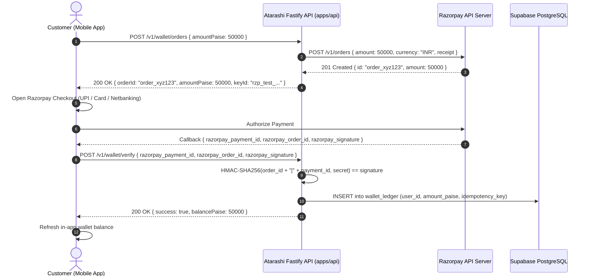

# Razorpay Payment Gateway & Logistics Wallet Integration Skill

## Overview
This skill provides complete technical specifications, lifecycle flows, server-authoritative security protocols, and client implementation patterns for integrating **Razorpay Payment Gateway** into the **Atarashi Logistics** parcel delivery platform.

In Atarashi Logistics:
- Backend: Fastify 5 + TypeScript in `apps/api`
- Database: Supabase PostgreSQL (`public.wallet_ledger`, `public.bookings`)
- **Strict Currency Standard: All monetary amounts are stored as integer PAISE** (`100 paise = ₹1.00`).
- Clients: Customer App (`apps/customer`) and Admin Console (`apps/admin`).

---

## 1. Security-Critical Architecture Principles

> [!IMPORTANT]
> **Server-Authoritative Rule**: NEVER initiate payments or mutate wallet balances directly on the client side.
> 1. Orders MUST be generated server-side using the Razorpay `Orders API` (`/v1/orders`) via `apps/api`.
> 2. The mobile client receives `order_id` and opens the Razorpay checkout interface.
> 3. After checkout completion, the client transmits `razorpay_payment_id`, `razorpay_order_id`, and `razorpay_signature` to `apps/api`.
> 4. `apps/api` cryptographically verifies the HMAC-SHA256 signature before inserting into `public.wallet_ledger` or updating `public.bookings`.



---

## 2. Server-Side Verification (Fastify 5 TypeScript)

```typescript
import crypto from 'node:crypto';
import type { FastifyPluginAsync } from 'fastify';
import Razorpay from 'razorpay';
import { z } from 'zod';

const razorpay = new Razorpay({
  key_id: process.env.RAZORPAY_KEY_ID!,
  key_secret: process.env.RAZORPAY_KEY_SECRET!,
});

export function verifyRazorpaySignature(orderId: string, paymentId: string, signature: string): boolean {
  const generatedSignature = crypto
    .createHmac('sha256', process.env.RAZORPAY_KEY_SECRET!)
    .update(`${orderId}|${paymentId}`)
    .digest('hex');
  return crypto.timingSafeEqual(Buffer.from(generatedSignature), Buffer.from(signature));
}
```

---

## 3. Webhook Handling & Idempotency
- Webhooks must be verified using `crypto.createHmac('sha256', process.env.RAZORPAY_WEBHOOK_SECRET)`.
- Use the `x-razorpay-event-id` or `payment.id` as the `idempotency_key` when inserting into `public.wallet_ledger`.
- If the idempotency key already exists, return `200 OK` without applying duplicate balance credits.
